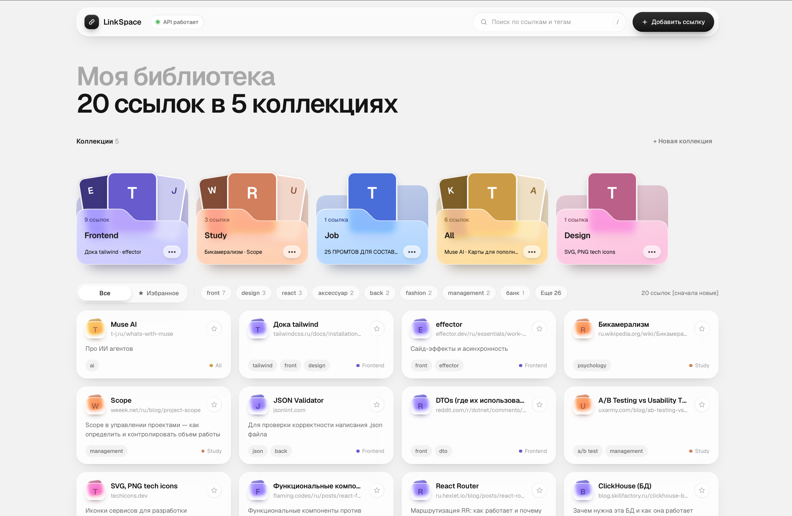

# LinkSpace

[](https://github.com/Pipchenkovaa/linkspace/actions/workflows/ci.yml)

LinkSpace — персональная библиотека полезных ссылок на FastAPI и Next.js. Сервис помогает хранить ссылки в одном месте, распределять их по коллекциям и тегам, добавлять в избранное и быстро находить через поиск и фильтры.

Версия 1.0.0 рассчитана на одного пользователя и работает без авторизации.



## Возможности

- коллекции, теги и избранное;
- поиск и комбинируемые фильтры;
- защита от дубликатов URL;
- перенос ссылок между коллекциями;
- хранение данных между перезапусками;
- web-интерфейс на Next.js.

Подробные продуктовые правила и решения описаны в [docs/mvp.md](docs/mvp.md).

## Стек

**Backend:** Python, FastAPI, Pydantic  
**Frontend:** Next.js, React, TypeScript  
**Тесты:** pytest  
**CI:** GitHub Actions

## Структура проекта

```text
linkspace/
├── app_final.py              # точка входа FastAPI
├── routers/                  # API-маршруты
├── models.py                 # модели данных
├── storage.py                # хранение данных
├── test_app.py               # backend-тесты
├── frontend/                 # Next.js-интерфейс
├── docs/                     # документация проекта
└── .github/workflows/ci.yml  # CI
```

## Быстрый запуск

### Backend

Нужен Python 3.11 или новее.

```bash
git clone https://github.com/Pipchenkovaa/linkspace.git
cd linkspace
python3 -m venv .venv
source .venv/bin/activate # Windows: .venv\Scripts\activate
python -m pip install -r requirements.txt
cp .env.example .env
uvicorn app_final:app --env-file .env
```

API: `http://127.0.0.1:8000`  
Swagger: `http://127.0.0.1:8000/docs`

При первом запуске создаётся папка `data/` с `collections.json` и `links.json`.

### Frontend

Нужен Node.js 20.9 или новее и запущенный backend.

```bash
cd frontend
npm install
cp .env.example .env.local
npm run dev
```

Интерфейс: `http://localhost:3000`  
Подробнее: [frontend/README.md](frontend/README.md).

## Конфигурация

| Переменная | Назначение | По умолчанию |
| --- | --- | --- |
| `DATA_DIR` | папка с данными | `data` |
| `LOG_LEVEL` | уровень логирования | `INFO` |
| `CORS_ORIGINS` | адреса frontend, которым разрешён доступ к API | `http://localhost:3000,http://127.0.0.1:3000` |

В Git хранится только шаблон `.env.example`. Настоящий `.env` и папка `data/` исключены через `.gitignore`.

Настройка frontend через `NEXT_PUBLIC_API_URL` описана в [frontend/README.md](frontend/README.md#конфигурация).

## Проверка приложения и логи

```bash
curl http://127.0.0.1:8000/health  # {"status":"ok"}
curl http://127.0.0.1:8000/version # {"version":"1.0.0"}
```

Логи выводятся в терминал, где запущен сервер; сообщения приложения помечены `linkspace`.

```text
INFO linkspace: Application started: version=1.0.0, data_dir=data
INFO linkspace: Link created: id=2, collection_id=2
WARNING linkspace: Duplicate link: existing_id=2
```

Подробная диагностика проблем с запуском, портами, окружением и CORS: [docs/troubleshooting.md](docs/troubleshooting.md).

## Тесты и CI

```bash
python -m pip install -r requirements-dev.txt
python -m pytest -v
```

Тесты используют временное хранилище и не изменяют локальную папку `data/`.

GitHub Actions запускается при каждом `push` и `pull request`:

- backend: `pytest`;
- frontend: lint и production build;
- после успешной проверки создаётся artifact `linkspace-app`.

Статус запусков доступен во вкладке [Actions](https://github.com/Pipchenkovaa/linkspace/actions).

## Документация

- [docs/mvp.md](docs/mvp.md) — продуктовые правила и API;
- [docs/deploy.md](docs/deploy.md) — развёртывание;
- [frontend/README.md](frontend/README.md) — устройство и запуск frontend;
- [docs/troubleshooting.md](docs/troubleshooting.md) — диагностика.

## Основа проекта

Проект развивает учебную основу `app_final.py`. Добавлены предметная модель LinkSpace, хранение данных, поиск и фильтрация, обработка дубликатов, автотесты, CI и frontend на Next.js.
